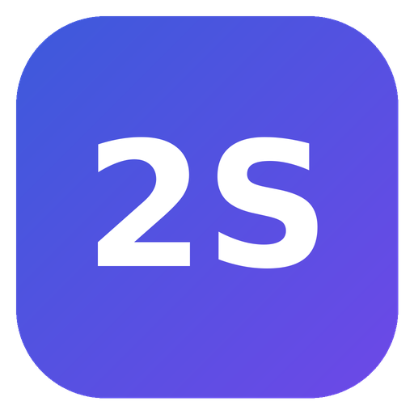
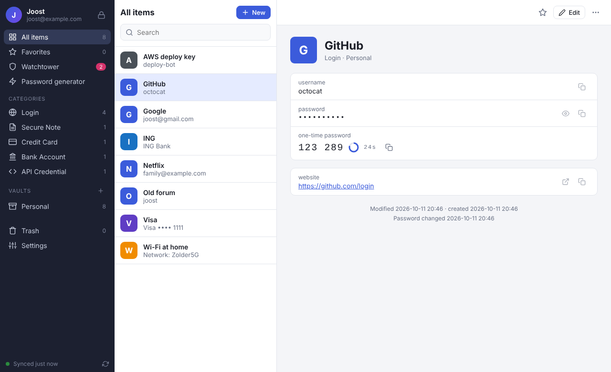
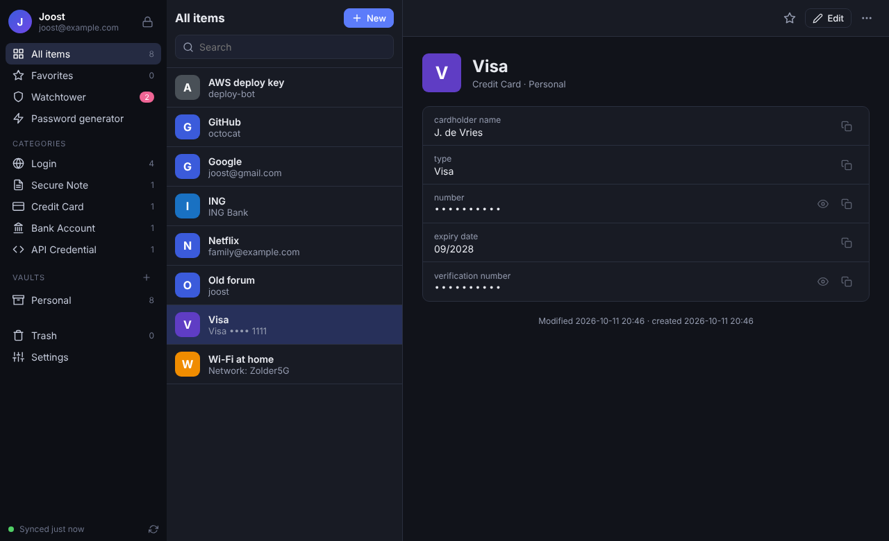
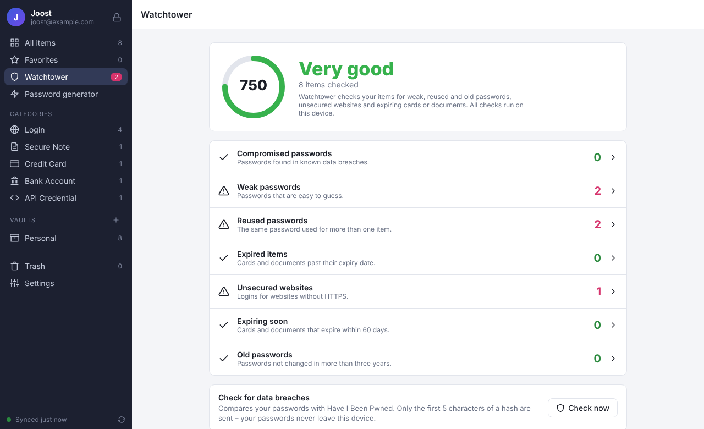
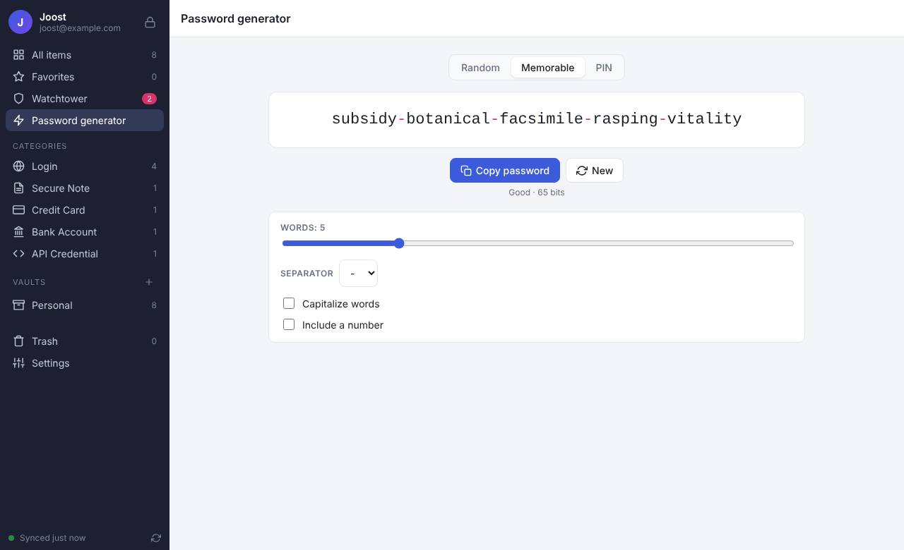

<p align="center">
  
</p>

<h1 align="center">2Secret</h1>

<p align="center">
  <b>A free, open-source password manager – one Rust codebase for macOS, Windows, Linux, the BSDs, iOS, the web and your browser.</b>
</p>

<p align="center">
  <a href="https://github.com/joostiphone/2Secret/actions/workflows/ci.yml"></a>
  
  
</p>

---

**🇳🇱 Nederlands:** [lees verder in het Nederlands](#-nederlands) ↓

<p align="center">
  
  
  
  
</p>

2Secret keeps your passwords, credit cards, notes, identities, SSH keys and
other secrets end-to-end encrypted. It works like 1Password – master password
**plus** a Secret Key, vaults you can share with family or colleagues,
Watchtower, a password generator, one-time codes and browser autofill – but it
is free, open source, and you can host the sync server yourself.

## Features

| | |
|---|---|
| 🔐 **Two-Secret Key Derivation** | Master password (Argon2id) combined with a 125-bit Secret Key that never leaves your devices. A stolen server database is useless for guessing passwords. |
| 🧱 **End-to-end encryption** | XChaCha20-Poly1305 for every item, per-vault keys, X25519 public-key encryption for sharing. The server only sees ciphertext. |
| 🗂️ **Vaults & sharing** | Multiple vaults; share a vault with other people on your server as *viewer*, *editor* or *manager*; leave or revoke access at any time. |
| 🧾 **19 item types** | Logins, passwords, secure notes, credit cards, identities, bank accounts (IBAN/BIC), crypto wallets, software licenses, SSH keys, API credentials, databases, servers, Wi-Fi routers, e-mail accounts, passports, driver licenses, memberships, reward programs and documents – plus custom fields, tags, favorites and encrypted file attachments. |
| ⏱️ **One-time passwords** | Built-in TOTP authenticator (RFC 6238, SHA-1/256/512, Steam Guard) with live codes. |
| 🛡️ **Watchtower** | Finds weak, reused and old passwords, unencrypted (`http://`) sites, expired and expiring cards/documents, and – opt-in – passwords from data breaches via Have I Been Pwned (k-anonymity: only 5 hash characters leave your device). |
| 🎲 **Password generator** | Random passwords, memorable passphrases (EFF wordlist) and PINs with entropy and strength estimates (zxcvbn). |
| 🔄 **Sync** | Offline-first; automatic sync with conflict resolution (no password is ever lost – the losing version goes into the password history). |
| 🧩 **Browser extension** | Chrome, Edge, Brave and Firefox: suggestions for the current site, one-click fill of username, password and one-time code. |
| ⌨️ **Keyboard friendly** | `Ctrl/⌘+F` search, `Ctrl/⌘+N` new item, `Ctrl/⌘+L` lock, `Esc` closes dialogs. |
| 💻 **CLI for developers** | `2secret read 2s://vault/item/field`, `2secret run -- cmd` and `2secret inject` keep secrets out of config files and CI. |
| 📥 **Import / export** | Import from 1Password (`.1pux`, CSV), Bitwarden (JSON, CSV), LastPass, Chrome, Edge, Firefox, Safari, KeePass (XML), KeePassXC, Dashlane; export to encrypted backups, JSON or CSV. |
| 🔒 **Auto-lock & clipboard clearing** | Configurable lock timeout; copied secrets are wiped from the clipboard. |
| 🌍 **English & Nederlands** | The apps follow your system language. |
| 🏠 **Self-hostable** | One small server binary (or Docker image) that also serves the web vault. |

## Platforms

All apps share one Rust codebase ([Dioxus](https://dioxuslabs.com) UI + the `twosecret-core` crate).

| Platform | App | How |
|---|---|---|
| macOS | desktop app (`.app`, `.dmg`) | `dx bundle --platform desktop` |
| Windows | desktop app (`.msi`, `.exe`) | `dx bundle --platform desktop` |
| Linux | desktop app (`.deb`, `.rpm`, AppImage) | `dx bundle --platform desktop` |
| FreeBSD, OpenBSD, NetBSD | desktop app, CLI, server | `cargo build` (WebKitGTK) |
| iOS / iPadOS | native app | `dx bundle --platform ios` (on macOS with Xcode) |
| Web | web vault in any browser (WebAssembly) | served by `2secret-server` |
| Browsers | extension for Chrome, Edge, Brave, Firefox | `extension/build.sh` |
| Terminal | `2secret` CLI | `cargo install --path crates/cli` |

## Quick start

### 1. Run your own sync server (optional)

A local-only vault works without any server. To sync between devices and share
vaults, run the server – it also serves the web vault:

```sh
docker compose -f deploy/docker-compose.yml up -d     # with automatic HTTPS via Caddy
# or
docker build -t 2secret . && docker run -p 8743:8743 -v 2secret-data:/data 2secret
```

See [docs/SELF-HOSTING.md](docs/SELF-HOSTING.md) for TLS, invite-only sign-ups, backups and systemd.

### 2. Install an app

Download a build from the [releases](https://github.com/joostiphone/2Secret/releases), or build one:

```sh
# Desktop (macOS, Windows, Linux, BSD) – Linux needs libwebkit2gtk-4.1-dev, libgtk-3-dev, libxdo-dev
cargo run --release -p twosecret-app

# Command line tool and server
cargo install --path crates/cli
cargo install --path crates/server
```

Create an account, **save your Emergency Kit** (it contains your Secret Key), and
you are done. On other devices choose *Sign in to an existing account*.

### 3. The CLI

```sh
2secret account create --server https://vault.example.com
eval "$(2secret unlock)"                     # unlock this shell for 30 minutes
2secret add login --title GitHub --username octocat --generate --url github.com
2secret list
2secret read "2s://Personal/GitHub/password"
DATABASE_PASSWORD="2s://Work/Postgres/password" 2secret run -- ./deploy.sh
2secret import ~/Downloads/1PasswordExport.1pux
2secret watchtower --breach-check
```

Full reference: [docs/CLI.md](docs/CLI.md).

## Security

2Secret's design follows 1Password's published security model:

- **Two secrets.** Keys are derived from your master password *and* a random
  Secret Key (`2S-XXXXXX-…`) generated on your device. The server never has
  enough information to brute-force your password.
- **Zero knowledge.** Item contents, titles, URLs, vault names and even the
  sync token are encrypted before they leave your device.
- **Modern primitives.** Argon2id (64 MiB, 3 passes), HKDF-SHA256,
  XChaCha20-Poly1305 with context-bound associated data, X25519 sealed boxes.
- **Defence in depth.** Server-side Argon2id over the authentication key,
  login rate limiting, strict Content-Security-Policy for the web vault,
  owner-only file permissions, secrets zeroized in memory.

Read the full white paper in [docs/SECURITY.md](docs/SECURITY.md). Found a
vulnerability? Please follow [SECURITY.md](SECURITY.md).

## Building from source

Requirements: Rust 1.85+ (`rustup`), and for GUI builds the
[Dioxus CLI](https://dioxuslabs.com/learn/0.7/getting_started) `dx` 0.7.

```sh
cargo test --workspace --exclude twosecret-app   # core, client, server, CLI (incl. end-to-end tests)

# Desktop
cargo run -p twosecret-app

# Web vault (output in crates/app/dist/public, serve it with 2secret-server --web-dir)
cd crates/app && dx bundle --platform web --release

# iOS (on macOS with Xcode)
cd crates/app && dx bundle --platform ios --release

# Browser extension (output in extension/dist)
./extension/build.sh

# FreeBSD / OpenBSD / NetBSD: install Rust plus the WebKitGTK 4.1 and GTK 3
# packages from your ports/packages collection, then:
cargo build --release -p twosecret-app -p twosecret-cli -p twosecret-server
```

## Project layout

```
crates/core     Crypto, vault & item model, sync merge, generator, TOTP, Watchtower, importers (no I/O, runs everywhere incl. WebAssembly)
crates/client   HTTP client and sync engine (native + WebAssembly)
crates/server   Zero-knowledge sync server (axum + SQLite) that also serves the web vault
crates/cli      The `2secret` command line tool
crates/app      The Dioxus app: desktop, web, iOS and the browser extension
extension/      Browser extension manifest and build script
deploy/         docker-compose, Caddyfile, systemd unit
docs/           Security white paper, self-hosting guide, CLI reference, architecture
```

More in [docs/ARCHITECTURE.md](docs/ARCHITECTURE.md).

## License

2Secret is free software, dual-licensed under the [MIT](LICENSE-MIT) or
[Apache 2.0](LICENSE-APACHE) license, at your option. The passphrase wordlist
is the [EFF large wordlist](https://www.eff.org/deeplinks/2016/07/new-wordlists-random-passphrases)
(CC BY 3.0 US); icons are from [Feather](https://feathericons.com) (MIT).

---

## 🇳🇱 Nederlands

**2Secret** is een gratis, open-source wachtwoordmanager – een volwaardig
alternatief voor 1Password, geschreven in één Rust-codebase voor macOS,
Windows, Linux, BSD, iOS, het web en je browser.

### Wat kan 2Secret?

- **Veilig door twee geheimen:** je hoofdwachtwoord (Argon2id) gecombineerd met
  een geheime sleutel van 125 bits die alleen op jouw apparaten staat. Zelfs
  met een gestolen serverdatabase kan niemand je wachtwoord raden.
- **End-to-end versleuteld:** alles wordt op je apparaat versleuteld
  (XChaCha20-Poly1305); de server ziet alleen versleutelde gegevens.
- **Kluizen en delen:** meerdere kluizen, te delen met gezin of collega's als
  *kijker*, *bewerker* of *beheerder*.
- **19 soorten items:** logins, wachtwoorden, notities, creditcards,
  identiteiten, bankrekeningen (IBAN/BIC), crypto-wallets, licenties,
  SSH-sleutels, API-sleutels, databases, servers, wifi, paspoorten,
  rijbewijzen en meer – met eigen velden, labels, favorieten en versleutelde
  bijlagen.
- **Eenmalige codes (2FA/TOTP)** ingebouwd.
- **Watchtower:** waarschuwt voor zwakke, hergebruikte en oude wachtwoorden,
  onbeveiligde websites, verlopen passen en (optioneel) gelekte wachtwoorden
  via Have I Been Pwned.
- **Wachtwoordgenerator** voor willekeurige wachtwoorden, wachtwoordzinnen en
  pincodes.
- **Synchronisatie** tussen al je apparaten via je eigen server, ook offline
  bruikbaar.
- **Browserextensie** (Chrome, Edge, Brave, Firefox) die inloggegevens en
  eenmalige codes automatisch invult.
- **Opdrachtregel (CLI)** voor ontwikkelaars, met `2s://`-verwijzingen naar
  geheimen.
- **Importeren** uit 1Password, Bitwarden, LastPass, Chrome, Firefox, Safari,
  KeePass, Dashlane en meer.
- **Automatisch vergrendelen** en klembord wissen.
- **Nederlands en Engels.**

### Snel aan de slag

1. **Server (optioneel):** `docker compose -f deploy/docker-compose.yml up -d`
   start een eigen server met automatische HTTPS. Zonder server werkt 2Secret
   gewoon lokaal op één apparaat. Zie [docs/SELF-HOSTING.md](docs/SELF-HOSTING.md).
2. **App:** download een versie bij *Releases* of bouw hem zelf met
   `cargo run --release -p twosecret-app`.
3. **Account aanmaken:** kies een sterk hoofdwachtwoord en **bewaar je noodkit**
   (die bevat je geheime sleutel). Op een ander apparaat kies je *Inloggen op
   een bestaand account*.

> ⚠️ Je hoofdwachtwoord en geheime sleutel kunnen door niemand worden
> hersteld – ook niet door de beheerder van de server. Print de noodkit en
> bewaar hem op een veilige plek.

### Licentie

Gratis en open source onder de MIT- of Apache-2.0-licentie (naar keuze).
